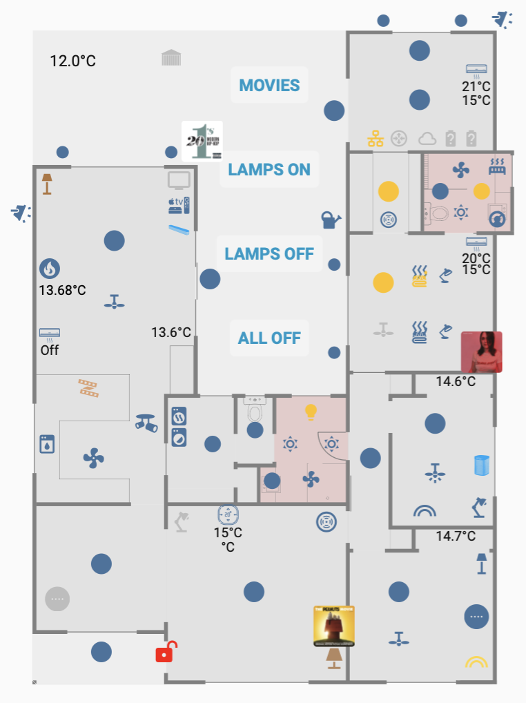

# SVG Floorplan Card

A Home Assistant dashboard card that shows your floorplan as an SVG and brings it to life:

- **SVG styling by state** – CSS classes on SVG elements change with entity state (lights on, doors open, rooms occupied).
- **Overlays** – state icons, state labels and action buttons placed anywhere on the plan, using Home Assistant's native state colours (dimmed and coloured lights, heating thermostats, locks and more).
- **Visual editor** – add and configure overlays in the card editor, and drag them into position on the preview, much like the built-in Picture Elements card.



## Installation

### Marketplace (HACS)

1. Open **Marketplace** (HACS) in Home Assistant.
2. Add this repository as a custom repository, category **Dashboard**: `https://github.com/hdcoffeeboy/ha_floorplan`
3. Install **SVG Floorplan Card**, then reload the browser.

### Manual

1. Copy `floorplan-card.js` to `config/www/floorplan-card.js`.
2. Add it as a dashboard resource: **Settings → Dashboards → ⋮ → Resources → Add resource**, URL `/local/floorplan-card.js`, type **JavaScript module**.
3. Reload the browser.

## Quick start

1. Draw your floorplan as an SVG. Give each element you want to control an `id` equal to its entity ID (for example `light.kitchen`).
2. Write a CSS file with the classes to apply in each state.
3. Put both in `config/www/floorplan/`.
4. Add the card to a dashboard and pick **SVG Floorplan Card**, or use YAML:

```yaml
type: custom:svg-floorplan-card
image: /local/floorplan/home.svg
stylesheet: /local/floorplan/home.css
groups:
  - entities:
      - light.kitchen
      - light.lounge
    states:
      - state: "on"
        class: light-on
      - state: "off"
        class: light-off
    action:
      service: toggle
overlays:
  - type: state_icon
    entity: light.kitchen
    x: 42%
    y: 35%
```

```css
/* home.css */
.light-on  { fill: #fdd835; fill-opacity: 0.4; }
.light-off { fill-opacity: 0; }
```

## Configuration

### Card

| Option | Required | Description |
| --- | --- | --- |
| `image` | yes | URL of the SVG floorplan. |
| `stylesheet` | yes | URL of the CSS file applied inside the SVG. |
| `title` | no | Card title. |
| `aspect_ratio` | no | Width ÷ height (for example `1.6`). Reserves space before the SVG loads. If omitted, the ratio from the last successful load is used. |
| `groups` | no | SVG elements styled or updated by entity state. See [Groups](#groups). |
| `style_rules` | no | Inline styles computed from entity state. See [Style rules](#style-rules). |
| `overlays` | no | Icons, labels and buttons placed over the plan. See [Overlays](#overlays). |

### Groups

Each group links entities to SVG elements whose `id` is the entity ID.

| Option | Description |
| --- | --- |
| `entities` | List of entity IDs. |
| `states` | List of `state` / `class` pairs. The element's `class` is set to the matching class, or `default` if no state matches. |
| `on_update: set_text` | Sets the element's text (or its single `<tspan>`) to the entity state plus its unit. |
| `action: { service: toggle }` | Clicking the element toggles the entity. Without it, clicking opens the more-info dialog. |

### Style rules

Set an SVG element's inline `style` from a JavaScript expression evaluated against the entity:

```yaml
style_rules:
  - entity: binary_sensor.bathroom_door
    elements:
      - id: doorBathroomOpen
        style: "display: ${ entity.state === 'on' ? 'inline' : 'none' };"
```

### Overlays

All overlays share these options:

| Option | Default | Description |
| --- | --- | --- |
| `type` | | `state_icon`, `state_label` or `action_button`. |
| `x`, `y` | `0` | Position as a percentage of the plan (for example `42%`). Only percentage positions can be dragged in the editor. |
| `anchor` | `center` | Which point of the overlay sits at `x`/`y`: `center`, `top-left`, `top-right`, `bottom-left`, `bottom-right`. |
| `scale` | `1` | Size multiplier. |

Actions (`tap_action`, `hold_action`, `double_tap_action`) use [Home Assistant's standard actions](https://www.home-assistant.io/dashboards/actions/): `toggle`, `more-info`, `perform-action`, `navigate`, `url`, `assist`, `none`. An action may name its own `entity`; otherwise the overlay's `entity` is used.

#### `state_icon`

Shows the entity's icon, coloured by Home Assistant exactly as the Picture Elements card does.

| Option | Description |
| --- | --- |
| `entity` | Entity ID (required). |
| `icon` | Icon override, for example `mdi:lamp`. |
| `icon_map` | Icon per state, for example `{ "on": mdi:lightbulb, "off": mdi:lightbulb-off }`. |
| `color_map` | Colour per state; overrides Home Assistant's colour. |
| `visible_states` | Only show the icon in these states. |
| `entity_picture` | `false` to never show media player artwork (shown while playing or paused). |
| `tap_action`, `hold_action`, `double_tap_action` | Actions (none by default). |

#### `state_label`

Shows text from an entity.

| Option | Description |
| --- | --- |
| `entity` | Entity whose state is shown. |
| `attribute` | Show this attribute instead of the state. |
| `suffix` | Text added after the value, for example `°C`. |
| `template` | Text with `{{ states('entity') }}` and `{{ state_attr('entity', 'attribute') }}` placeholders. Overrides `entity`/`attribute`. |
| `style` | CSS properties, for example `{ font-size: 12px, font-weight: 600 }`. |

#### `action_button`

A text and/or icon button.

| Option | Description |
| --- | --- |
| `label` | Button text. |
| `icon` | Button icon. |
| `entity` | Entity used by `toggle` and `more-info` actions. |
| `style` | CSS properties. Setting `background` disables the hover tint. |
| `tap_action`, `hold_action`, `double_tap_action` | Actions. |

## Visual editor

Open the card's editor to:

- edit the image, stylesheet, title and aspect ratio;
- add, reorder, edit and delete overlays;
- **drag overlays on the preview** to position them, or select one and click the plan to place it.

Groups, style rules, icon/colour maps and styles are edited as YAML fields within the editor.

## Credits

Based on [floorplan-card](https://github.com/chr1st1ank/floorplan-card) by chr1st1ank (Apache 2.0), itself a fork of [ha-floorplan](https://github.com/ExperienceLovelace/ha-floorplan) by ExperienceLovelace (Apache 2.0). Overlay behaviour inspired by Home Assistant's Picture Elements card.

## Licence

[Apache License 2.0](LICENSE)
